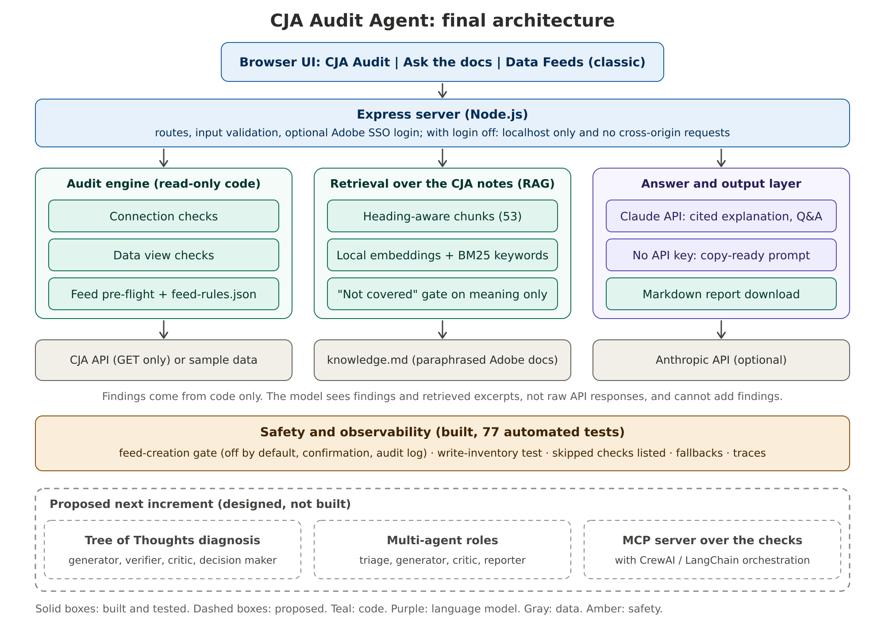

# CJA Audit Agent

A read-only, evidence-grounded assistant that helps analytics and data engineers **audit and troubleshoot
Adobe Customer Journey Analytics (CJA)** setups: connections, data views, and data feeds.

It combines deterministic checks (so findings are exact and repeatable), retrieval over documentation notes (so
explanations are cited), and a language model that may only explain what the checks found. It is advisory: a person
decides and acts.

**Try it:** [live demo](https://cja-audit-agent.onrender.com) (sample data, read-only) · [final report](docs/final-capstone-report.md) · [quick start](#quick-start-for-reviewers-no-accounts-or-keys-needed)



## The problem

Getting CJA right means getting a chain of dependent pieces right: the connection and its datasets, the data view
built on it, and a data feed built on the data view. Failures cross layers (an empty feed can come from a dataset
that stopped importing, a component with no data, a time zone, or the feed's own dates), and the evidence is spread
across APIs, the interface and documentation. A wrong fix to a connection setting affects data volume.

## What it does

| Request | What happens |
|---|---|
| **Audit a data view and its connection** | Deterministic read-only checks, with severity, evidence and a next step. Checks that cannot run are listed, never guessed |
| **Check a planned data feed** | Every requested column is resolved against the data view (with "did you mean" suggestions) and checked against Adobe's published feed rules, dates, lookback, delay and compression |
| **Explain findings** | Retrieves the matching documentation notes and writes a cited explanation of the high and medium findings only |
| **Ask the docs** | Answers questions from the notes, with the sections used shown. Says so when the notes do not cover the question |
| **Download a report** | Markdown report of findings, column statuses and the explanation |

Scope boundaries: the audit **never changes anything in Adobe**. CJA data feeds cannot be read through the API (no
public endpoint was found), so the tool validates a *planned* feed instead of inspecting existing ones.

## Status: what is built and what is proposed

| Part | Status |
|---|---|
| Audit checks, feed pre-flight, GET-only CJA client, built-in sample data | **Built, tested** |
| Hybrid retrieval (heading-aware chunks, local embeddings, BM25 keywords, meaning-only "not covered" gate) | **Built, tested** |
| Cited explanation and Q&A through the Claude API, or a copy-ready prompt when no key is set | **Built, tested** |
| Safety controls: guarded feed creation, write audit log, write-inventory test, fallbacks, traces | **Built, tested** |
| Tree of Thoughts diagnosis, multi-agent roles, MCP server, CrewAI/LangChain orchestration | **Designed, not built** (see `docs/`) |

## Quick start for reviewers (no accounts or keys needed)

Requires Node.js 18 or newer (the LTS version from https://nodejs.org).

**No command prompt needed:** download or clone the repository, then

- **Windows:** double-click `start.bat`
- **macOS or Linux:** run `./start.sh`

On the first run it installs what it needs, starts the server and opens your browser when it is ready. Close the
window to stop it.

**Or from a terminal:**

```
git clone https://github.com/loveeshk/cja-audit-agent.git
cd cja-audit-agent
npm install
npm test            # 77 offline tests: mock embedder, fake model client, no network
npm start           # then open http://localhost:3000
```

With no `.env` file, **login is off**, the audit runs on clearly labelled **sample data** (it contains deliberate
problems), and the server listens on this computer only. Open **CJA Audit**, click **Run audit**, then **Fill with
an example** and **Validate plan** in step 2. Sample outputs are in [`examples/`](examples/).

The first start downloads a small local embedding model (about 25 MB from huggingface.co) and builds the retrieval
index. If that fails, the app still starts and answers from the full notes, with a notice.

To turn on explanations and Q&A, copy `.env.example` to `.env` and set `ANTHROPIC_API_KEY`. Without a key those two
features return the exact prompt with a **Copy prompt** button so you can paste it into a chat with Claude.

## Hosted demo

**Live demo: https://cja-audit-agent.onrender.com** (sample data only; the first visit after a quiet period takes about a minute while the free service wakes up)

[](https://render.com/deploy?repo=https://github.com/loveeshk/cja-audit-agent)

A public, read-only demo can be deployed to [Render](https://render.com) from `render.yaml` (the button above, or
New > Blueprint and pick this repository). It sets `PUBLIC_DEMO=true`, which at startup **removes every Adobe credential and the Anthropic
key, forces the labelled sample data and keeps feed creation off**, and only then lets the server listen publicly
(see `demo-mode.js`, tested in `test/demo-mode.test.js`). Explain and Ask work in copy-prompt mode. On the free plan the
service sleeps when idle, so the first visit can take about a minute.

## The web interface

| Part | What it shows |
|---|---|
| **Status strip** (top of every page) | In plain words: sample or live data, whether answers come from Claude or copy-prompt mode, retrieval index size, whether login is on, whether feed creation is allowed, and that the audit is read-only. Hover over a pill for the detail. It never shows keys or secrets |
| **CJA Audit** | Run the audit, check a planned feed, explain the findings, download the report |
| **Ask the docs** | Questions answered from the notes, with sources. Open **Why these sources?** to see every candidate the retriever examined with its similarity and keyword scores |
| **Data Feeds (classic)** | List classic Adobe Analytics feeds. Creating one is off by default and needs confirmation |
| **Report Builder** | Query a CJA data view directly (needs Adobe credentials) |

## Usage

```
npm test                              # 77 offline tests
npm run rag:eval                      # semantic vs keyword vs hybrid retrieval accuracy, weight sweep, threshold report
npm run rag:table -- "your question"  # retrieval trace for one question as a paste-ready table (no key needed)
npm run rag:report                    # rag:eval plus the two report traces, saved to examples/retrieval-results.md
npm run rag:compare                   # same question with no notes / full notes / retrieval (needs ANTHROPIC_API_KEY)
npm run rag:prompts                   # the same three prompts without a key, to paste into a chat
npm run examples                      # regenerate examples/ from the sample data
```

Inspect retrieval without calling the model: `GET /api/rag/trace?q=your question` and `GET /api/rag/status`.

## Evaluation

| What | Result |
|---|---|
| Automated tests | 77 tests: audit checks, feed rules, retrieval, keyword channel, no-key mode, credential guards, write guards, public demo lockdown |
| Deliberate defects (11 guardrail and check bugs introduced on purpose) | Each was caught by a failing test |
| Browser run on sample data (headless Chromium, stand-in server and stub model) | Audit, feed check, explain, report download, Ask and the feed-creation confirmation all work. Cancelling the confirmation sent 0 requests, accepting sent 1 |
| Retrieval, semantic only, measured on the author's machine | One real miss (Q1) and one correct-but-fragile result (Q2): [`examples/retrieval-traces-semantic-baseline.md`](examples/retrieval-traces-semantic-baseline.md) |
| Retrieval, keyword channel alone on 18 questions (deterministic, offline) | Correct section in the top 4 for 18/18, first for 13/18, MRR 0.843 |
| Retrieval with the real model, 18 questions ([`examples/retrieval-results.md`](examples/retrieval-results.md)) | Correct section in the top 4: semantic only 15/18, hybrid 18/18 (MRR 0.684 → 0.866, keyword weight 0.5 chosen from a sweep) |
| "Not covered" threshold (0.30), 5 out-of-scope questions | 3/5 refused; 1/18 in-scope would be wrongly refused. The ranges overlap, so this is a known weakness |

The 18 evaluation questions in `eval/questions.json` are a small set written by the project author, so they show
that retrieval finds the right section, not how it behaves on questions nobody anticipated. The live Adobe client
has not been run against a real environment. Full detail is in [`docs/`](docs/).

## Safety

- The audit only makes GET requests, and a test fails if a write verb appears in its client.
- The one action that changes Adobe is creating a classic data feed. It is **off by default**
  (`ALLOW_FEED_CREATION`), needs an explicit confirmation that the server checks again, and every attempt is written
  to `logs/write-audit.jsonl` (who, what, outcome, never credentials).
- A "write inventory" test lists every non-GET call in the code. Adding a new one fails the test until it is reviewed.
- With login off the server binds to `127.0.0.1` and refuses cross-origin requests, and it warns loudly if feed
  creation is on while login is off. The only way to listen publicly without login is `PUBLIC_DEMO=true`, which first
  strips every credential and the only write.
- The model sees findings and retrieved excerpts, cannot add findings, and cites its sources. Text from the
  environment is treated as data. When the notes do not cover a question, the model is not called.

## Repository layout

| Path | Purpose |
|---|---|
| `demo-mode.js`, `render.yaml` | Public demo lockdown and the Render deployment blueprint |
| `server.js`, `core.js` | Express server, answer pipeline (retrieval, prompts, fallbacks, no-key mode) |
| `audit/` | `checks.js` (the checks), `feed-rules.json` (Adobe's published feed rules), `cja-client.js` (GET-only client), `mock-data.js` (sample data), `explain.js`, `report.js`, `routes.js` |
| `rag.js` | Chunking, local embeddings, BM25, hybrid retrieval, threshold gate |
| `knowledge.md` | The CJA reference notes (paraphrased Adobe documentation with source URLs, plus labelled audit tool notes) |
| `feeds-routes.js`, `cja-routes.js` | Classic Adobe Analytics data feeds (with the guarded write) and the CJA report builder |
| `public/` | Browser UI |
| `test/` | Automated tests |
| `scripts/`, `eval/` | Evaluation and example scripts, evaluation questions |
| `examples/` | Sample inputs and outputs, and the real baseline retrieval traces |
| `docs/` | Design write-ups: retrieval, Tree of Thoughts, multi-agent, safety and oversight |

## Configuration

Everything is optional for the quick start. See `.env.example` for all values.

| Goal | Values |
|---|---|
| Explanations and Q&A | `ANTHROPIC_API_KEY` |
| Audit your real CJA data views | `ADOBE_S2S_CLIENT_ID`, `ADOBE_S2S_CLIENT_SECRET`, `ADOBE_S2S_SCOPES`, `ADOBE_ORG_ID`. The credential needs the Customer Journey Analytics API **and** the Experience Platform API. Without the latter, CJA calls fail with "User region is missing" |
| Sign-in with Adobe SSO | `ADOBE_CLIENT_ID`, `ADOBE_CLIENT_SECRET`, `ADOBE_REDIRECT_URI`, `SESSION_SECRET`. Login turns on once these are set |
| Create classic data feeds | `ADOBE_GLOBAL_COMPANY_ID` plus `ALLOW_FEED_CREATION=true` |
| Retrieval tuning | `RAG_MIN_SCORE`, `RAG_LEX_WEIGHT`, `RAG_TOP_K`. Choose them from the output of `npm run rag:eval` |

Connection checks need an account with product administration privileges. Without it the audit still runs the data
view checks and reports the connection as not readable.

## Limitations

- Existing CJA data feeds cannot be seen (no public API found); only planned feeds are validated, and feed name
  uniqueness must be checked in the CJA interface.
- The live Adobe client follows Adobe's published API documentation and is tested against fake responses, but has not
  been run against a real environment. Which `expansion` fields Adobe returns may differ, and the audit lists the
  checks it had to skip.
- The data feed documentation was labelled Limited Testing. `audit/feed-rules.json` and `knowledge.md` record the date
  they were checked and must be re-checked when Adobe's pages change. The notes are a paraphrase, not Adobe's text.
- The evaluation set is small (18 + 5 questions). The keyword weight and threshold were chosen from it, and the
  threshold lets 2 of 5 off-topic questions through to the model.
- Tree of Thoughts, multi-agent coordination and an MCP server are designs in `docs/`, not working code.
- Sample data can be mistaken for real data if the banner is ignored.
- Logs contain user questions and should be treated as sensitive.

## Development note

Code and documentation were developed with assistance from an AI assistant (Claude), then verified by running the
automated tests and the application locally.
