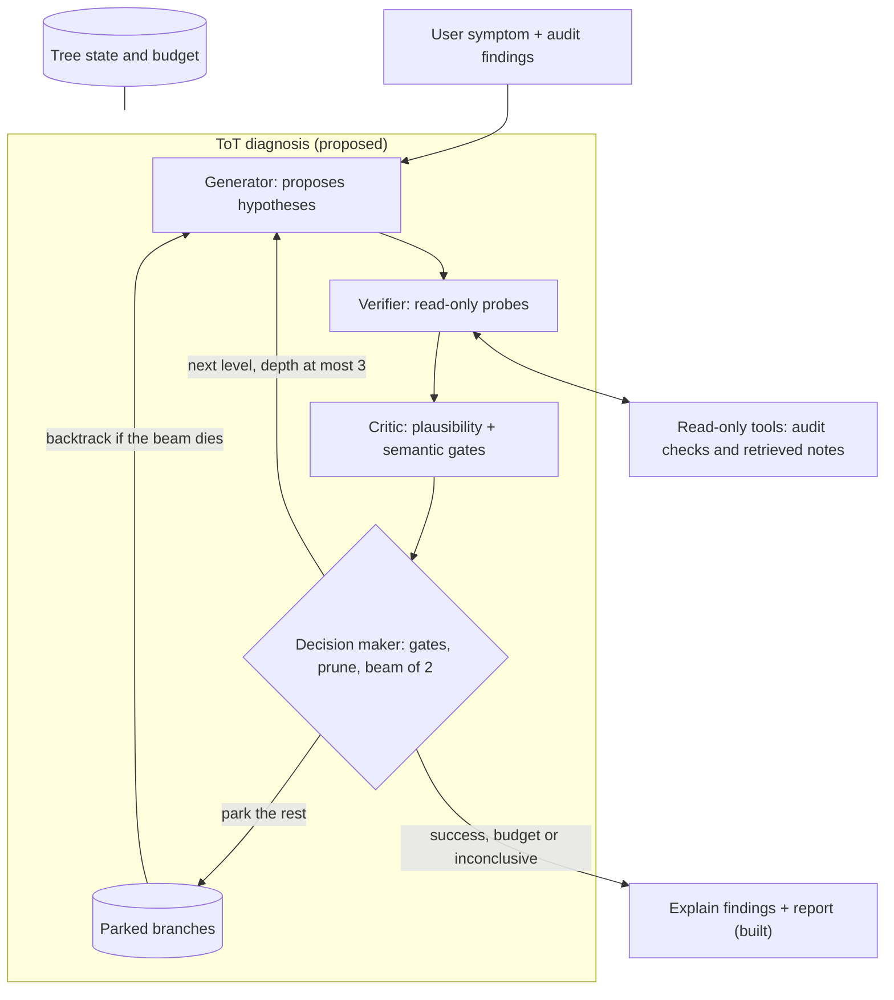

# Module 4: Tree of Thoughts (ToT) reasoning (paste-ready)

**Read this first.** This module is a design for the next increment of the CJA Audit tool. The tool as built
has deterministic checks, retrieval and a cited explanation step. It has **no ToT code, and it does not use
CrewAI, LangChain or MCP** (it is a Node/Express app). Section 8 says exactly what exists and what is proposed.
Measurements that would come from running the scenarios in section 7 are marked **not yet measured**, because that has not been done.
Numbers that are design limits (call budgets, beam width) are decisions, not measurements.

---

## 1. Where ToT is required, and why a linear chain of thought is not enough

The audit workflow has five stages. Only one needs search over alternatives.

| Stage | Method | Why |
|---|---|---|
| Run audit checks on the connection and data view | Deterministic code | The answer is computed, not reasoned |
| Validate a planned feed | Deterministic rules (`feed-rules.json`) | Rules are fixed and exact |
| Retrieve the matching notes | Hybrid semantic and keyword retrieval | A lookup, not a decision |
| Explain the findings | One model call, linear reasoning | The findings are given facts, so there is nothing to search |
| **Diagnose a symptom** ("yesterday's feed was empty", "call center data stopped appearing") | **Tree of Thoughts** | The cause is unknown, many causes are plausible, and the evidence arrives step by step |

A lighter second use is choosing an export route (CJA data feed, dataset export, or Query Service plus export).
That is a ToT of depth 1: generate the options, score them against the user's constraints, keep the best.

**Why linear chain of thought is insufficient for diagnosis**

1. **Many plausible causes across layers.** An empty feed can come from the connection (new data not imported,
   stale ingestion, failed backfill), the data view (missing component, empty component, time zone), the feed
   configuration (dates, columns) or delivery and availability. A linear chain picks one and elaborates it.
2. **Evidence arrives during the investigation.** Each probe result changes which next step makes sense. A
   chain cannot abandon a path when a probe contradicts it. It either ignores the contradiction or restarts.
3. **Early errors cascade.** In a chain, step 3 inherits step 1's assumption. A wrong first guess about the
   cause makes the remediation advice wrong too, in an area where connection settings affect data volume.
4. **Partial observability.** The CJA API exposes no data feed definitions (none was found in Adobe's API
   documentation), so some causes cannot be confirmed by the tool. A chain tends to assert. A tree holds the
   alternatives open and asks the user to check them.

ToT builds on chain of thought. Each thought is itself a short reasoned step. ToT adds generating several of them,
testing them, and discarding the ones the evidence rejects.

## 2. Proposed ToT structure

**What a thought (reasoning state) is.** One falsifiable hypothesis plus the probe that can test it. A state is
the symptom, the path of thoughts from the root, the facts established and the causes ruled out.

| Field | Meaning |
|---|---|
| `layer` | connection, data view, feed configuration, or delivery and availability |
| `claim` | one sentence root cause or mechanism |
| `predicted` | what would be observed if the claim is true |
| `probe` | a named read-only check and its arguments (or `ask_user`) |
| `outcome` | supports, contradicts or inconclusive, plus the facts returned |
| `cites` | audit finding ids, API fields, or retrieved note ids |
| `scores`, `gates`, `status` | see section 3. Status is open, supported, contradicted, parked, pruned or chosen |

**Levels, branching and depth**

| Level | Thought is | Generated | Kept for the next level |
|---|---|---|---|
| 1 | Root cause hypothesis | 4 (must cover at least 3 different layers) | beam of 2 |
| 2 | Mechanism refinement: which dataset, field or setting, with a sharper prediction | 2 per kept parent (4 total) | beam of 2 |
| 3 | Remediation option with reversibility, risk and how to verify | 2 per kept parent (4 total) | best 1 to 2 |

**Limits:** depth at most 3, beam width 2, breadth 4 / 2 / 2. A run is also capped at **9 model calls**,
**10 probes** and **90 seconds**.

**Termination.** The search stops at the first of these:

1. **Success:** a supported hypothesis scores at least 0.80 and level 3 has produced its remediation options.
2. **Adaptive narrowing:** if the leader is supported and ahead of the runner-up by at least 0.15, the beam
   narrows to 1 for the remaining levels.
3. **Depth limit:** level 3 is complete.
4. **Budget:** any cap in the table above is reached. The report says the search was cut short.
5. **No survivor:** every branch is contradicted or below the prune threshold and nothing is parked. The report
   says "inconclusive", lists what was ruled out, and lists what the user should check by hand.
6. **User cancels.**

**Worked example (illustrative, not measured).** Symptom: "Call center data has stopped appearing." Inputs
below are assumed to show the arithmetic with the weights in section 3 (`S = 0.5 E + 0.2 D + 0.3 P`).

| Thought | Probe result | E | D | P | S | Outcome |
|---|---|---|---|---|---|---|
| H1 New data not imported for the call center dataset | supports | 1.0 | 1.0 | 0.8 | **0.94** | kept (leader) |
| H2 Ingestion stale for that dataset | supports | 1.0 | 0.5 | 0.7 | **0.81** | kept |
| H3 Feed dates or columns misconfigured | inconclusive (feeds not readable) | 0.4 | 1.0 | 0.6 | **0.58** | **parked**, not discarded |
| H4 Data view has no time zone | contradicts (time zone is set) | n/a | n/a | n/a | n/a | discarded for good |

Level 2 then separates cause from effect for H1 and H2 (stale ingestion is a likely consequence of the import
setting being off) and level 3 proposes remediation, such as confirming the import setting and checking recent
batches first. H3 stays in the parked list and is restored if the leaders later fail.

## 3. Evaluation and pruning mechanism

**Who evaluates.** The generator never scores its own thoughts.

| Evaluator | Type | Produces |
|---|---|---|
| Verifier | Deterministic code, calls the read-only probes | Evidence score `E` and hard gates G1, G2, G3 |
| Critic | Separate LLM agent, different prompt, temperature 0, sees one thought plus the symptom and established facts, **never sibling scores** | Plausibility score `P`, and the semantic checks for G3 and G5 |
| Decision maker | Deterministic code | Combines scores, prunes, selects the beam, decides to backtrack or finish |

**Hard gates (a thought failing any gate is discarded without scoring)**

| Gate | Rule |
|---|---|
| G1 Read-only | The probe is on the whitelist of GET-only checks |
| G2 Grounded | The thought cites at least one finding id, API field or retrieved note |
| G3 Falsifiable | It states a predicted observation and a probe that could contradict it (or marks `ask_user`) |
| G4 Distinct | Not a near duplicate of a sibling (embedding similarity above 0.9) |
| G5 Safe | A remediation is advisory only (the tool is read-only) and states its reversibility |

**Score:** `S = 0.5 E + 0.2 D + 0.3 P`, each from 0 to 1.

| Part | Definition |
|---|---|
| `E` evidence (deterministic) | supports = 1.0, inconclusive = 0.4. **Contradicts is not scored: the branch is discarded.** |
| `D` documentation | 1.0 if an Adobe documentation chunk reaches the similarity cut set from `rag:eval`; 0.5 if only an audit tool note supports it; 0 if none |
| `P` plausibility (LLM critic) | mean of three rubric items rated 0 to 1: fits the symptom, mechanism is coherent, testable with the evidence available |

Evidence carries the largest weight on purpose, so a fluent but wrong critic cannot override a probe.

**Probe outcomes map onto what the audit already does.** *Supports* means the check ran and found the predicted
condition. *Contradicts* means it ran, the needed field was returned, and it shows otherwise. *Inconclusive*
means the field was not returned or the system is unreadable. The audit already lists those as "skipped".

**Pruning rules (applied after each level)**

1. Failed a gate: discard.
2. Contradicted by a probe: discard permanently.
3. `S` below the prune threshold 0.35: discard.
4. Passed but ranked below the beam: **park** (kept, not discarded).
5. Keep the top 2 by `S`, with at least one from a different layer than the leader when its `S` is at least 0.35.
6. Ties go to the cheaper probe.

**Backtracking.** If the whole beam ends contradicted or inconclusive at a level, the best parked branches are
restored and re-expanded. If nothing is parked, the result is "inconclusive".

The weights and thresholds (0.5 / 0.2 / 0.3, 0.35, 0.80, 0.15) are starting values to be tuned on the
labelled scenarios in section 7.

## 4. Search strategy: beam search

**Chosen: level-by-level beam search** (breadth-first with pruning), width 2, depth 3.

| Strategy | Model calls (generation + evaluation + report) | Fit for this problem | Main drawback |
|---|---|---|---|
| Single linear chain | 1 to 2 | Cheapest | The weaknesses in section 1 |
| Self-consistency (5 chains and a vote) | about 6 | Simple | Samples the same prior five times, uses no probes, cannot rule anything out |
| Full BFS (no pruning) | up to 17 | Complete | 28 thoughts evaluated, calls roughly double |
| DFS with backtracking | 3 to 17, variable | Cheap when the first guess is right | Commits to the first plausible path (the chain's flaw) and runs serially |
| Monte Carlo tree search | Many | Powerful for large spaces | Too much machinery for a space of about a dozen thoughts |
| **Beam search (4 / 2 / 2, beam 2)** | **at most 9** | **Fits** | Can discard the true branch early (section 7 handles this) |

Beam calls: generation 1 + 2 + 2 = 5, critic 3 (one batched call per level), final report 1, total 9.
Thoughts evaluated: 4 + 4 + 4 = 12, against 28 for full BFS.

**Trade-offs**
- **Compute:** the beam bounds cost. Probes run on audit data that is already loaded, so they add almost no API
  calls to Adobe.
- **Latency:** levels run in series, so there are about 7 sequential model round trips. At several seconds each
  (an assumption; seconds per run are **not yet measured**) a run is tens of seconds, which is why a 90 second cap
  exists. Parallel work within a level keeps it near that figure.
- **Complexity:** a level-synchronous loop needs only a list per level, which is simple to implement, trace and
  test. DFS and MCTS need backtracking stacks or statistics.
- **Risk accepted:** a beam of 2 can drop the true cause if early scoring is wrong. Section 7 describes the
  protections (parked branches, evidence outranking opinion, layer diversity).

## 5. Mapping ToT roles to CrewAI, LangChain and MCP

All three are proposals. I checked the current capabilities named below in their documentation.

| ToT role | CrewAI | LangChain | MCP |
|---|---|---|---|
| **Thought generator** | An Agent (role, goal, backstory) run through a Task per level | Prompt templates and `with_structured_output(...)` with a Pydantic `Thought` schema, so the output is validated | Calls `retrieve_notes`, reads findings |
| **Verifier (probes)** | A plain Flow step, no LLM | Thin tool wrappers if needed | **MCP server tools**: `probe_import_enabled`, `probe_freshness`, `probe_backfill`, `probe_identity`, `probe_lookup_keys`, `probe_component_data`, `probe_timezone`, `validate_feed_plan`, `retrieve_notes` |
| **Critic / evaluator** | A separate Agent with its own prompt, temperature 0, and **no tools** | Structured output `CriticScore` (three rubric items) plus `with_retry` | None. It only sees structured input |
| **Decision maker** | A Flow `@router` that returns `backtrack`, `ask_user`, `inconclusive` or `finish`. The gates, scoring and beam selection are ordinary Python, not an LLM, so runs are repeatable | None (deterministic code) | None |
| **State management** | Flow structured (Pydantic) state: tree, beam, parked list, budget counters, with Flow persistence to resume | None needed | Optional MCP resource `tot://runs/{id}`. Trace stored in a `thought_nodes` table (the design from the earlier module), or JSONL to start |
| **Reporter** | Agent or direct call, reusing the existing explain step | Retriever over the notes | `retrieve_notes` |

**Why this split**
- The checks, the CJA client and the retriever **stay in Node**. They become an MCP server, so the tested code
  remains the single source of truth and nothing is rewritten.
- The Python side (CrewAI Flow with the agents) is the orchestrator and an MCP client.
- LangChain supplies typed model output and retrieval plumbing. Its MCP adapter package loads MCP tools. I would
  confirm the exact adapter calls against the current documentation at build time.
- **MCP's read-only annotation is a hint to clients, not enforcement.** The guarantee stays where it is today:
  the Node client contains only GET requests and a test fails if a write verb appears.
- Loops over levels are written as ordinary Python inside one Flow step. The Flow's `@router` is used for the
  branching decisions (finish, backtrack, ask the user), which avoids depending on cyclic flow behaviour.

**Design sketch (not run; the structure is from the CrewAI Flows documentation):**

```python
from crewai.flow.flow import Flow, listen, router, start
from pydantic import BaseModel

class TotState(BaseModel):
    symptom: str = ""
    beam: list = []          # kept thoughts for the current level
    parked: list = []        # passed the gates but ranked below the beam
    calls_used: int = 0
    outcome: str = ""

class DiagnoseFlow(Flow[TotState]):
    @start()
    def intake(self):                    # load audit findings through the MCP tools
        ...
    @listen(intake)
    def search(self):                    # for level in 1..3: generate -> verify -> critique -> decide
        ...                              # generator and critic are Agents; verify and decide are plain code
    @router(search)
    def route(self):
        return self.state.outcome        # "finish" | "ask_user" | "inconclusive"
    @listen("finish")
    def report(self): ...
```

## 6. Updated architecture and workflow

The diagram above (Figure 3 in your document) shows ToT between the audit findings and the explanation.
A text version for tools that render Mermaid:



**Workflow**
1. The user states a symptom. The audit runs (built) and produces findings.
2. **Level 1:** the generator proposes 4 hypotheses across at least 3 layers. The verifier probes each, the critic
   scores it, the decision maker applies the gates and pruning, keeps 2, and parks any other branch that passed.
3. **Level 2:** each kept hypothesis is refined into a specific mechanism and tested again.
4. **Level 3:** remediation options are generated for the survivors and checked for reversibility and safety.
5. Termination (section 2) decides when to stop. Unreadable systems produce an `ask_user` step instead of a guess.
6. The result goes to the existing explain step, which cites retrieved notes. The full tree, including pruned
   branches and the reason for each, is saved in the report.

## 7. ToT-specific failure modes and how the design handles them

**Primary: premature pruning.** An early score based on little evidence can kill the true cause, for example a
critic that gives low prior plausibility to "import setting is off" because the symptom was worded differently.

| Mitigation | How it works |
|---|---|
| Only evidence discards for good | Only a probe that **contradicts** or a failed gate removes a branch permanently. Low scores park a branch |
| Inconclusive is not zero | Unreadable or missing evidence scores a neutral 0.4, not 0 |
| Evidence outranks opinion | `E` has weight 0.5 against 0.3 for the critic, so a supporting probe survives a pessimistic critic |
| Backtracking | If the beam dies, parked branches are restored and re-expanded |
| Layer diversity | At least one branch from a different layer than the leader is kept when it passes the threshold |
| Auditability | Every pruned branch is logged with its reason so a wrong prune can be found afterwards |
| Measured | Metric: is the true cause in the beam after level 1? Target on the scenarios below: every time. Result: **not yet measured** |

**Weak evaluation signals.** LLM scores are poorly calibrated and tend to favour fluent text. Mitigated by
deterministic evidence as the largest weight, a separate critic that never sees sibling scores, a three-item
rubric, temperature 0, and a rule that a probe contradiction overrides any critic score (the disagreement is
flagged in the report). The weights are checked against outcomes on the labelled scenarios.

**Branch explosion.** Mitigated by the caps (4 / 2 / 2, beam 2, depth 3), the 9 call, 10 probe and 90 second
budget, the distinctness gate G4, adaptive narrowing, and a length cap on thought text.

| Other risk | Handling |
|---|---|
| Generator repeats the same cause (mode collapse) | G4 plus the rule that level 1 spans at least 3 layers |
| The tool cannot read feed definitions or the destination | Inconclusive, and an `ask_user` thought. A user answer counts as evidence with its source recorded |
| Text from the environment (component names, error strings) contains instructions | Passed as structured data. Fields are whitelisted and truncated as the explain step already does |
| Unsafe advice | Remediations are advisory, state reversibility, and the tool stays read-only |
| ToT costs more than it helps | Section 7 evaluation, with the adoption rule below |

**Evaluation plan (not yet run).** Seed known faults into the sample data and compare a single-call chain-of-thought
diagnosis (same findings and notes) against the proposed ToT.

| Scenario | True cause in the sample data |
|---|---|
| S1 "Call center data stopped appearing" | New data not imported for that dataset (stale ingestion is the effect) |
| S2 "People counts differ between web and call center" | Different identity namespaces |
| S3 "Product names are empty in the feed" | Lookup dataset has no key field |
| S4 "A Region column in the feed is empty" | Component reports no data |
| S5 "Last year's backfill has gaps" | A failed backfill |
| S6 control: "The feed looks fine, anything wrong?" | No fault. Tests false alarms |

Measure: true cause ranked first, true cause in the final top 2, claims without a citation or evidence, model calls,
probes, seconds. **Results: not yet measured** (the design has not been implemented). **Adoption rule, decided before running:** keep ToT for this stage only if it
improves top-1 accuracy or unsupported-claim rate on the multi-cause scenarios (S1, S2). Otherwise keep the linear
chain and say so.

## 8. Implementation status

| Part | Status |
|---|---|
| Deterministic checks (become the probes), read-only client, GET-only test | **Built and tested** |
| Retrieval over the CJA notes, with hybrid search and traces | **Built and tested** |
| Explain step with citations, sample data | **Built and tested** |
| Thought generator, critic, decision maker, state and trace store | **Proposed, not built** |
| Probe wrapper returning supports / contradicts / inconclusive | **Proposed** (the checks already distinguish the three cases) |
| MCP server over the checks | **Proposed** |
| CrewAI Flow and agents, LangChain structured output | **Proposed** (the current tool is Node and uses none of them) |
| Scenario evaluation (section 7) | **Not run** |

A smaller first step that needs no new framework: implement the same roles in the existing Node code
(generator and critic as model calls, verifier and decision maker as plain functions), run the scenarios, and only
then decide whether the orchestration frameworks are worth adding.
