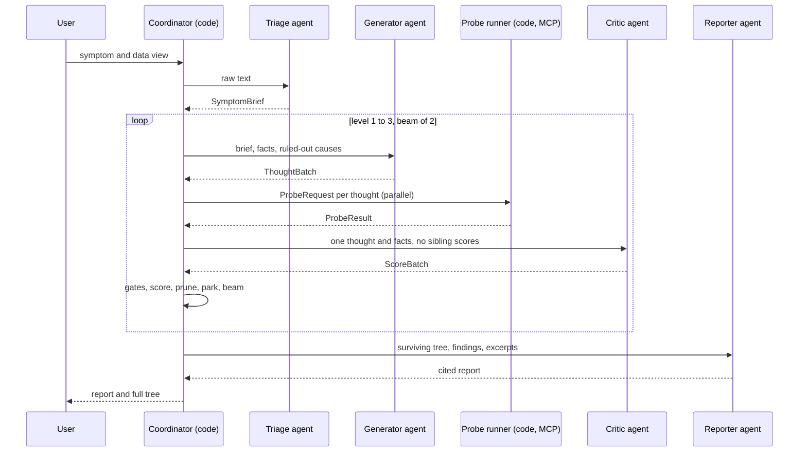

# Module 5: Multi-agent architecture (paste-ready)

**Status:** this is a design proposal for the next increment of the CJA Audit tool. The tool today has the deterministic audit checks and retrieval over the CJA notes. The agents below are not yet implemented. Counts of calls and messages are design estimates, not measurements. The design builds on the ToT roles (Module 4), retrieval (Module 3) and the reasoning loop (Module 2).

---

## 1. The problem, and why a multi-agent approach is appropriate

**Problem.** Analytics and data engineers who set up Customer Journey Analytics (CJA) have to get a chain of
dependent pieces right: the connection and its datasets, the data view built on it, and a data feed built on the
data view. Failures cross layers. An empty feed can come from new data not being imported, stale ingestion, a
missing component, a time zone, or the feed's own dates, and the evidence is scattered across the API, the
interface and the documentation. Engineers lose hours tracing it, and a wrong fix to a connection setting affects
data volume. The tool answers three kinds of request:

| Request | Example |
|---|---|
| **Diagnose a symptom** | "Call center data stopped appearing in reports" |
| **Check a planned data feed** | "Is this column list and schedule valid for this data view?" |
| **Answer a documentation question** | "Can CJA data feeds be delivered over SFTP?" |

**Why more than one agent.** A multi-agent design is justified here by four specific reasons, not by default.

1. **Independent evaluation.** In diagnosis, one model that both proposes causes and grades them tends to confirm
   its own first idea. A separate critic with a different prompt, which never sees the other branches' scores,
   removes that self-grading (the "weak evaluation signal" risk from Module 4).
2. **Least privilege.** Only one component, the probe runner, touches Adobe's API, and it is code that can only do
   GET requests. The model agents have no direct access to any system. This limits what a hallucinated or
   manipulated instruction can do. A single agent with every tool has the widest possible reach.
3. **Different jobs, different cost.** Structuring a request, scoring a hypothesis and writing a cited report need
   different context, strength and cost. Separate agents keep each prompt small and let cheap, fast model tiers
   do the narrow jobs.
4. **Testability.** Each role has a typed input and output, so each can be tested alone with a fake model, as the
   existing checks and retrieval already are.

**What is deliberately not an agent.** The audit checks, the feed rules, the probe execution, the scoring
arithmetic and the beam selection are exact, repeatable computations. Putting a language model there would add
cost and error. The design rule is: **an agent exists only where judgment is needed and where independence or
privilege separation adds reliability.**

**An honest limit.** A single agent playing all the roles through different prompts is a viable alternative. The
multi-agent design should be adopted only if it beats that baseline when tested on the diagnosis scenarios from
Module 4 (accuracy, unsupported claims, cost). If it does not, the simpler design stays.

## 2. Multi-agent architecture

**Five working components plus a coordinator: four LLM agents, one code component, and a deterministic
coordinator.** The diagram above shows how they connect.

| # | Component | Type | Role and responsibility | Sees | Must not |
|---|---|---|---|---|---|
| 1 | **Triage agent** | LLM (small, fast tier) | Turns the user's free text into a structured `SymptomBrief` (symptom type, layers it points to, data view, time frame, at most one clarifying question). Routes the request to diagnose, plan check or docs question. Refuses requests that need changes, since the tool is read-only | User text, data view name | Call tools, see findings or scores |
| 2 | **Generator agent** | LLM (strong tier) | Proposes hypotheses (level 1), mechanism refinements (level 2) and remediation options (level 3) as validated `Thought` objects. At level 1 it must cover at least 3 layers | `SymptomBrief`, established facts, ruled-out causes, retrieved note excerpts | Score thoughts, see numeric scores, call Adobe |
| 3 | **Probe runner** | **Code, no LLM** | Runs the named read-only probe for a thought and returns supports, contradicts or inconclusive plus the facts. Implemented by the existing audit checks, exposed over MCP | A `ProbeRequest` only | Do anything outside the whitelist of GET-only probes |
| 4 | **Critic agent** | LLM (small, fast tier) | Scores plausibility on a three-item rubric and checks the semantic gates (falsifiable, safe). Runs at temperature 0, with no tools | One thought, the `SymptomBrief` and the facts | See sibling scores, the generator's reasoning, or call tools |
| 5 | **Reporter agent** | LLM (strong tier) | Writes the cited explanation, remediation advice and the final report from the surviving tree, the audit findings and retrieved excerpts. Also answers documentation questions | Final tree summary, findings, excerpts | Add findings, or state product behaviour without a citation |
| C | **Coordinator** | **Deterministic code** (a CrewAI Flow) | Routes requests, calls the others in order, applies the hard gates and the scoring formula, prunes and parks branches, selects the beam, enforces budgets, decides to backtrack, ask the user or finish | Everything | Make judgment calls with a model |

**How this maps to the earlier modules.**

| Earlier design | Component here |
|---|---|
| Module 4 thought generator | Generator agent |
| Module 4 verifier | Probe runner |
| Module 4 critic | Critic agent |
| Module 4 decision maker and state manager | Coordinator and shared state |
| Module 3 retrieval | Notes retrieval tool, used by the Generator (context) and the Reporter (citations) |
| Module 2 loop: Observe / Plan / Branch and evaluate / Act / Verify / Update | Triage and probes / Coordinator / Generator and Critic / advisory only / Probe runner / Shared state |

**Count and why.** Four LLM agents is the smallest set that keeps generation, evaluation, request handling and
writing apart. Each extra agent adds a model call, latency and a message contract, so none was added without a
distinct reason.

## 3. Coordination strategy

**Topology: orchestrator and workers around shared state (a star, not a conversation).** One deterministic
coordinator controls every step. Agents do not call each other and do not hold a group chat. This was chosen over
two alternatives: a free-form agent conversation, which is flexible but hard to bound and audit, and an LLM
"manager" agent, which adds a model call per decision and makes runs non-repeatable.

**Execution structure.** Stages run in order, with a barrier between stages. Work inside a stage runs in parallel.

**Route A: diagnose a symptom (the main flow, uses ToT).**

1. Coordinator calls **Triage**, which returns a validated `SymptomBrief` (or one clarifying question).
2. Coordinator runs the audit (built) and loads the findings into shared state.
3. For levels 1 to 3, repeat:
   1. Coordinator sends **Generator** the brief, established facts and ruled-out causes, and receives a `ThoughtBatch`.
   2. Coordinator sends a `ProbeRequest` for each thought to the **Probe runner**, in parallel, and receives the results.
   3. Coordinator sends each thought with its facts to the **Critic**, one batched call, and receives a `ScoreBatch`.
   4. Coordinator applies the gates and `S = 0.5 E + 0.2 D + 0.3 P`, prunes, parks, and keeps the beam of 2.
   5. Coordinator checks the termination rules (Module 4): success, depth limit, budget, no survivor, user cancel.
4. Coordinator sends the surviving tree, findings and retrieved excerpts to **Reporter**, which returns a cited report.
5. The report and the full tree, including pruned branches and reasons, are returned to the user.

**Route B: check a planned feed.** Coordinator runs the deterministic feed validator (built). The Reporter adds an
explanation only if the user asks. No search, so no Generator or Critic.

**Route C: documentation question.** Coordinator retrieves notes (built) and passes them to the Reporter, which
answers with citations or says the notes do not cover it.

**Human in the loop.** When a probe is inconclusive because the system is unreadable (for example existing feed
definitions), the Coordinator pauses with an `ask_user` message. The user's answer is recorded as evidence with
its source.

**Failure handling: a degradation ladder.** Each step down still produces a useful, honest result.

| Level | Condition | Behaviour |
|---|---|---|
| 0 | All components healthy | Full multi-agent ToT |
| 1 | Critic unavailable or invalid after one retry | Score from evidence and documentation only (weights renormalised), flagged in the report |
| 2 | Generator unavailable or invalid after one retry | No search: deterministic audit findings and one explanation call (**built today**) |
| 3 | MCP probe service down | Run the audit in-process with the existing modules, or report that the environment cannot be read |
| 4 | No model key | Return the copy-ready prompt with the retrieved excerpts (**built today**) |

| Fault | Handling |
|---|---|
| Agent returns invalid structure | Retry once with the validation error, then drop that thought |
| Agent call takes over 30 seconds | One retry, then step down the ladder |
| Probe returns an HTTP 403 or 5xx | Recorded as inconclusive, never as contradicts |
| Critic and probe disagree strongly | The probe wins and the disagreement is flagged |
| No progress or a loop | Depth cap and the call, probe and 90 second budget |



## 4. Communication approach

**Pattern: a shared blackboard plus typed messages, mediated by the coordinator.** Agents never address each
other. The Coordinator hands each agent only what it needs and writes the reply into shared state. Messages are
structured JSON validated against a schema, not free text. This keeps token use low, makes every exchange
checkable, and lets the Critic stay blind to the other branches.

**Envelope (every message):**

```json
{ "run_id": "r-0192", "msg_id": "m-014", "parent_id": "m-013", "from": "coordinator", "to": "critic",
  "type": "ScoreRequest", "level": 2, "schema_version": 1,
  "budget_remaining": { "calls": 5, "probes": 4, "seconds": 61 }, "payload": { } }
```

**Message catalogue**

| Message | From to | Payload | Validation |
|---|---|---|---|
| `SymptomBrief` | Triage to Coordinator | symptom type, layers, data view, time frame, optional question | Schema; length caps |
| `ThoughtBatch` | Generator to Coordinator | list of `Thought` (layer, claim, predicted, probe, cites) | Pydantic schema via LangChain structured output; hard gates G1 to G5 |
| `ProbeRequest` / `ProbeResult` | Coordinator to/from Probe runner | probe name and args; outcome, facts, finding ids | Probe must be on the whitelist; outcome is one of three values |
| `ScoreRequest` / `ScoreBatch` | Coordinator to/from Critic | one thought and facts; three rubric ratings | Ratings 0 to 1; no extra fields |
| `Decision` | Coordinator to shared state | kept, parked, pruned with reasons | Written by code only |
| `UserQuestion` / `UserAnswer` | Coordinator to/from user | question; answer and source | Recorded as evidence |
| `ReportRequest` / `Report` | Coordinator to/from Reporter | tree summary, findings, excerpts; text with citations | Every product claim needs a citation |
| `Error` | any to Coordinator | code, message, retryable | Triggers the failure table |

**Need-to-know (what each agent receives).**

| Agent | Receives | Never receives |
|---|---|---|
| Triage | User text, data view name | Tool output, scores |
| Generator | Brief, facts, ruled-out causes, note excerpts | Numeric scores, critic output |
| Probe runner | One `ProbeRequest` | Anything else |
| Critic | One thought, brief, facts | Sibling scores, the generator's reasoning |
| Reporter | Final tree, findings, excerpts | Raw API responses |

**Agents to tools: MCP.** The probe runner and notes retrieval are served over the Model Context Protocol, a
JSON-RPC based protocol, from a Node server that wraps the existing checks, the GET-only client and the retriever.
MCP's read-only annotation is only a hint to clients, so enforcement stays in the server code and its test, which
fails if a write verb appears. Probe results use the same three outcomes as the audit.

**Persistence and traceability.** Every message is appended to a run trace (JSONL to start, the `thought_nodes`
table later) with its `run_id`, `msg_id` and `parent_id`, so a run can be replayed and audited, including why a
branch was pruned.

**Security.** Names, error strings and component labels from Adobe are data. They travel only as JSON fields,
are truncated and whitelisted as the current explain step already does, and the prompts tell agents to ignore
instructions found inside them.

**Implementation mapping.** CrewAI Flow with typed state holds the coordinator and the blackboard, and the
Generator, Critic, Triage and Reporter are CrewAI Agents. LangChain supplies validated structured output and the
retriever. Agent calls within a stage can run concurrently (CrewAI crews can be kicked off asynchronously).

## 5. Design decisions and trade-offs

| Decision | Alternative considered | Reliability gain | Cost and complexity |
|---|---|---|---|
| **Four LLM agents, no more** | One agent; or 8 or more fine-grained agents | Enough separation for independence and least privilege | More than one agent costs calls and contracts; more agents multiply message paths and failure points |
| **Deterministic coordinator** | An LLM manager agent (CrewAI hierarchical process) | Repeatable runs, bounded cost, easy tests | Cannot improvise a new step; every route is written in code |
| **Blackboard with typed messages** | Free agent-to-agent chat | Auditable, schema-checked, small prompts, critic stays blind | Rigid; new information types need a new schema |
| **Independent critic** | Generator scores itself | Reduces self-confirmation | 3 more model calls and some latency (small model tier, one batched call per level) |
| **Probe runner is code** | An agent that decides which tool to call | Exact results, no invented tool use | New probes need code, the set is fixed |
| **Only the probe runner touches Adobe** | Give agents direct tool access | Smallest possible blast radius | One extra layer of indirection |
| **Stage barriers, parallel within a stage** | Fully asynchronous agents | Deterministic order, simple state | Slower than full overlap when one call is slow |
| **Model tiers by job** | One strong model for all | Lower cost for narrow jobs | Needs per-role quality testing before a tier is chosen |
| **Python orchestrator + Node MCP server** | Everything in Node | Reuses tested checks and retrieval unchanged | Two languages and a network hop. Fallback: implement the same roles in Node |
| **Degradation ladder** | Fail on first error | Always returns something honest | More paths to test |
| **Keep the single-agent baseline** | Commit to multi-agent | An evidence-based adoption rule | Extra evaluation work |

**Coordination overhead (design estimates).**

| Measure | Single agent | Proposed multi-agent |
|---|---|---|
| Model calls per diagnosis | 1 to 2 | 10 at most (triage 1, generator 5, critic 3, reporter 1) |
| Sequential model round trips | 1 to 2 | about 8 |
| Typed messages per run | none | about 30 |
| Direct Adobe API access by a model | possible | none |

**Reliability versus complexity, in one line.** The design spends complexity (contracts, a coordinator, a second
language) to buy independence in evaluation, repeatable control flow and a small blast radius. If testing on the Module 4
scenarios does not show a gain, the extra complexity is not justified.

**Risks the design accepts:** more latency than one agent; a cross-language hop; critic and generator models can
share blind spots if they come from the same provider; prompt and schema versions must be kept in step.
