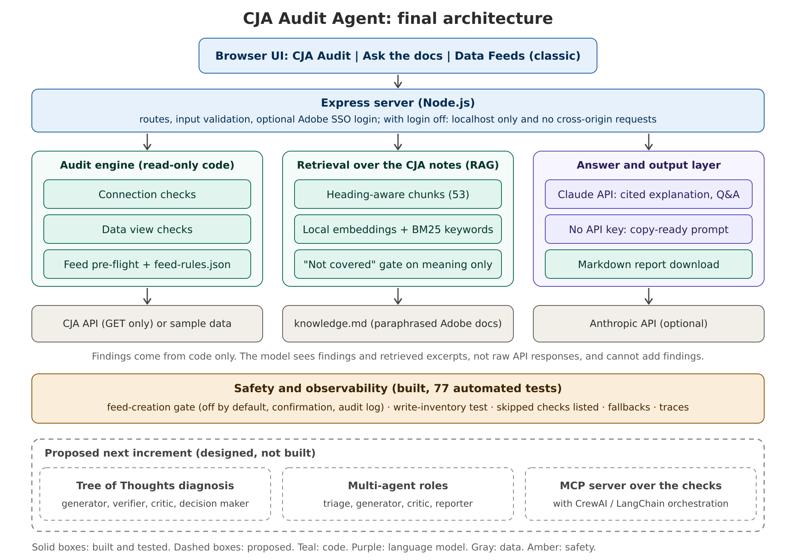

# Final Capstone Report

Agentic AI Program: Building Autonomous Systems for Real-World Applications

**Loveesh Kumar** · November 2026

## 1. Project title

**CJA Audit Agent: a read-only, evidence-grounded assistant for auditing Adobe Customer Journey Analytics (CJA) connections, data views and data feeds**

## 2. Problem and intended user

CJA only produces trustworthy reports and exports when a chain of dependent pieces is set up correctly: the connection and its datasets, the data view built on it, and the data feed built on the data view. Failures cross those layers. An empty feed can come from a dataset that stopped importing, a component with no data, a person ID that does not line up between datasets, or the feed's own dates and columns. The evidence is spread across APIs, the interface and changing documentation, so engineers diagnose it by hand for hours, and a wrong connection fix changes how much data CJA ingests.

**Intended users:** analytics engineers, data engineers and implementation consultants who set up or inherit CJA environments.

**Why a prompt alone is not enough:** a model cannot see the user's setup or verify a fix, may state outdated product details, and keeps no record of what was checked.

## 3. System goal and scope

**Goal:** help a person understand what is wrong, or could go wrong, in a CJA setup, using exact read-only checks and explanations cited from retrieved documentation. The system advises; a person decides and acts.

**What it does:** audits a data view and its connection; validates a planned feed against Adobe's published rules; explains findings with citations; answers documentation questions, saying plainly when the notes do not cover one; produces a report.

**Success criteria:** every seeded fault is reported and healthy data raises nothing above low; every statement about CJA behaviour cites a source; uncovered questions are refused, not guessed; nothing in Adobe changes without recorded approval; anything not checked is listed.

**Out of scope:** automatic fixes, reading existing CJA feeds (no public API), other Adobe products, multi-tenant production use.

## 4. Final architecture and major components

A browser UI calls an Express server that routes each request to one of three flows:

1. **Audit:** a GET-only CJA client loads the data view, components and connection (or labelled sample data). Deterministic checks in `audit/checks.js` produce findings with severity, evidence and a next step. Checks whose data Adobe did not return are skipped and listed.
2. **Planned feed check:** a validator driven by `audit/feed-rules.json`, which holds Adobe's published feed rules as data with their source and check date.
3. **Explain and Ask:** hybrid retrieval over `knowledge.md` (53 heading-aware chunks, local `all-MiniLM-L6-v2` embeddings plus BM25 keywords). The model receives only the findings and numbered excerpts and must cite them. If nothing passes a meaning-only threshold, the model is not called.

**Key design choice:** findings come from code, never from the model. The model only explains, so it cannot invent a problem in the user's environment.

| Course concept | In the system | Status |
|---|---|---|
| Reasoning loop | Observe → verify (checks) → retrieve → advise → record | Built (linear) |
| Tools | CJA API (GET), retrieval, Claude API, one guarded write | Built |
| Memory | Conversation history, cached index, trace logs | Partly built |
| Retrieval | Hybrid search, refusal gate, visible sources | Built, measured |
| Tree of Thoughts | Beam search over root-cause hypotheses | Designed |
| Multi-agent | Triage, generator, critic, reporter with a code coordinator | Designed |

## 5. How the design evolved

| Module | Key change and why |
|---|---|
| 1. Problem framing | Started from creating CJA feeds; learned existing feeds cannot be read by API, so the goal became *audit and validate a plan* |
| 2. Agent design | Added the reasoning loop, tools and memory; made tools read-only by default |
| 3. Retrieval | Replaced whole-document prompting with retrieval. My traces showed semantic search missed "which columns cannot be included", so I added a keyword channel and tuned its weight by measurement |
| 4. Tree of Thoughts | Designed hypothesis search that weights probe evidence above model opinion |
| 5. Multi-agent | Designed agents only where independent judgement adds reliability; exact work stays in code |
| 6. Safety review | Found that the classic feed tab could create a feed in one click; added an off-by-default guard, confirmation, audit log and a test that fails on any new write |

I built the verifiable parts first; Tree of Thoughts and multi-agent will be adopted only if they beat a single-agent baseline.

## 6. Implementation overview

Node.js 18+ and Express; Claude through the Anthropic SDK for explanations only; `@xenova/transformers` for local embeddings; a custom BM25 index; the CJA API with OAuth Server-to-Server credentials; Node's built-in test runner. About 3,300 lines of code and 1,000 lines of tests.

- Hybrid score = semantic similarity + 0.5 × keyword score + a small boost for exact identifiers; the refusal threshold applies to semantic similarity only.
- With no API key, Ask and Explain quote the retrieved notes verbatim with sources, so nothing is generated.
- A public demo on Render (`PUBLIC_DEMO=true`) removes every credential and the API key at startup.
- Developed with AI assistance (Claude), verified by tests and local runs.

## 7. Evaluation methods and results

| Method | Result |
|---|---|
| 77 automated tests (checks, feed rules, retrieval, refusal gate, credentials, write guards, demo lockdown) | 77/77 pass |
| Seeded faults in sample data | All reported: 18 findings (2 high, 5 medium, 5 low, 6 info); a healthy fixture raises nothing above low |
| 13 injected bugs, one at a time (`npm run eval:mutations`) | 13/13 caught. The first run caught 10/13 and exposed three untested rules, which I then covered |
| Browser run (headless Chromium, one-off) | All flows work; cancelling feed creation sent 0 requests, confirming sent 1; one real UI bug found and fixed |

**Retrieval, real embedding model, 18 in-scope questions** (the system passes the top 4 chunks to the model):

| Setting | hit@1 | hit@4 | MRR |
|---|---|---|---|
| Semantic only | 9/18 | 15/18 | 0.684 |
| Keyword only | 13/18 | 18/18 | 0.843 |
| Hybrid, initial weight 0.3 | 13/18 | 17/18 | 0.833 |
| **Hybrid, chosen weight 0.5** | **14/18** | **18/18** | **0.866** |

For "Which columns cannot be included in a CJA data feed?" the answering section moved from 18th to 4th. I chose 0.5, the middle of a flat region (0.4–0.75), over the single highest value.

**Refusal threshold:** on-topic and off-topic scores overlap (lowest correct section 0.245, highest off-topic question 0.38). At 0.30, 3 of 5 off-topic questions are refused and 1 of 18 on-topic questions would be wrongly refused.

**What the evidence does not cover:** AI-written explanation quality (no API key was available), a run against a real Adobe environment, and questions beyond my own 18. Full outputs are in `examples/`.

## 8. Safety, reliability and human oversight

- **Read-only by default:** the audit makes only GET requests, and a test fails if a write verb appears in its client.
- **One guarded write:** creating a classic feed is off by default, needs explicit confirmation that the server re-checks, and is logged without credentials. A write-inventory test fails the build if a new write appears.
- **Grounding:** the model sees only findings and excerpts, cannot add findings, and is not called when nothing relevant is retrieved. Environment text is treated as data, not instructions.
- **Fallbacks:** missing index → full notes with a notice; no API key → quoted notes and a copy-ready prompt; missing Adobe field → check skipped and listed.
- **Human oversight:** the system advises and a person acts. Findings implying a production change, "not covered" answers and skipped checks need review. The operator can disable feed creation, force sample data or remove the key.

## 9. Limitations and future improvements

**Limitations:** existing CJA feeds cannot be inspected; the live client is untested against a real environment; the notes paraphrase documentation that was in Limited Testing; the evaluation set is small and author-written; the threshold lets 2 of 5 off-topic questions through; Tree of Thoughts is a design only.

**Next steps:** audit a real CJA environment; add a reranker and real-world questions; check citations automatically; build Tree of Thoughts and compare it with a single-chain baseline; alert on denied writes and credential errors.

## 10. Public GitHub repository and demo

**Repository:** [https://github.com/loveeshk/cja-audit-agent](https://github.com/loveeshk/cja-audit-agent). README (project, architecture, setup, usage), `examples/` (sample inputs, outputs, evaluation results) and `docs/` (detailed design write-ups).

**Live demo:** [https://cja-audit-agent.onrender.com](https://cja-audit-agent.onrender.com) (read-only, sample data; the first visit can take a minute).

**Acknowledgement:** thank you to Carnegie Mellon University for the Agentic AI program.

**Run locally (no accounts or keys):** clone, then `npm install`, `npm test`, `npm start` (or double-click `start.bat`).

## 11. Presentation video

**Video link:** [https://youtu.be/ylwiIbckVbk](https://youtu.be/ylwiIbckVbk) (9:54, unlisted: anyone with the link can view it).

**Summary:** This presentation introduces the CJA Audit Agent, a read-only, evidence-grounded assistant that helps analytics and data engineers audit Adobe Customer Journey Analytics setups and planned data feeds. It walks through the architecture and key design decisions (deterministic checks for every finding, hybrid retrieval for cited explanations, guardrails that keep the tool advisory) and shows a live demo. The evaluation shows all 77 tests and 13 injected-bug checks passing and retrieval improving from 15 to 18 of 18 questions, alongside the remaining limitations and next steps.
